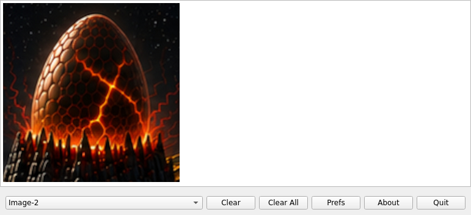
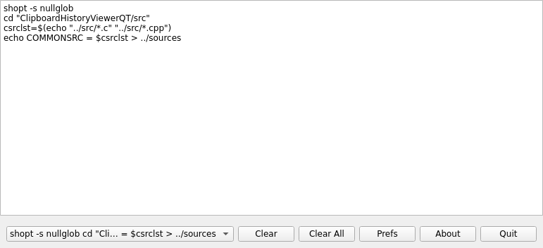
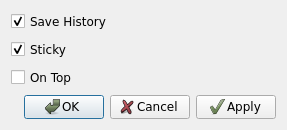

## Clipboard History Viewer QT
A QT based clipboard viewer and clipboard history.

  
  
  

  

  \
Every time you copy text or an image it will be added to the app.  
To retrieve a previous clip just select from the dropdown and the text or image will be recopied to the clipboad, then just paste as normal.  
Copying an image file now adds the image then the file uri.  
Prefs, Sticky, On Top are self explanatory, if Save History is selected, on exit clips are saved and reloaded on restart.  
Clear clears the current item.  
Clear All clears all history.  
  \
Compile with:  
```
./autogen.sh --prefix=/usr
make
sudo make install
```


